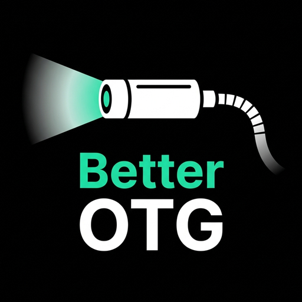

# BetterOTG

100% open-source, offline Android viewer for **USB OTG** (On-The-Go) digital microscopes, endoscope/borescope "snake" cameras, and standard UVC webcams — built from source for **F-Droid**.

<p align="center">
  
</p>

## Features (v1.0)
- **Zero Internet / Zero Ads / Zero Trackers** — no Play Services, no `INTERNET` permission, `dependenciesInfo` disabled.
- **100% Source-Built Native UVC Stack** — compiles vendored `libusb v1.0.27` (LGPL-2.1) + `libuvc v0.0.7` (BSD-3-Clause) + custom C++17 JNI bridge directly via Android NDK + CMake (`arm64-v8a` & `armeabi-v7a`).
- **Live Inspection & Microscope Tools** — MJPEG & YUYV streaming, dynamic resolution/FPS picker, 1×–8× pinch-to-zoom & pan, 90° rotation, H/V mirror, Fit/Fill toggle, sticky immersive fullscreen, Keep Screen On, and Picture-in-Picture floating window mode.
- **Measurement & Comparison** — `mm` / `inch` measurement reticle overlay and dual-screen freeze comparison.
- **Hardware UVC Controls** — Brightness, Contrast, Saturation, Sharpness, Gamma, Gain, Backlight, Hue/Tone, Manual/Auto Focus + Reset.
- **Capture & Built-in Gallery** — JPEG snapshots (`Pictures/BetterOTG`), hardware-accelerated H.264 MP4 video recording (`Movies/BetterOTG`), optional date/time watermark, physical USB shutter button support, and tabbed Images/Videos gallery with multi-select delete, share, and playback.

## Building From Source
```bash
./gradlew assembleRelease
```

## License
- BetterOTG application & JNI bridge: **GPL-3.0-or-later** ([LICENSE](LICENSE))
- `app/src/main/cpp/third_party/libusb`: LGPL-2.1
- `app/src/main/cpp/third_party/libuvc`: BSD-3-Clause
